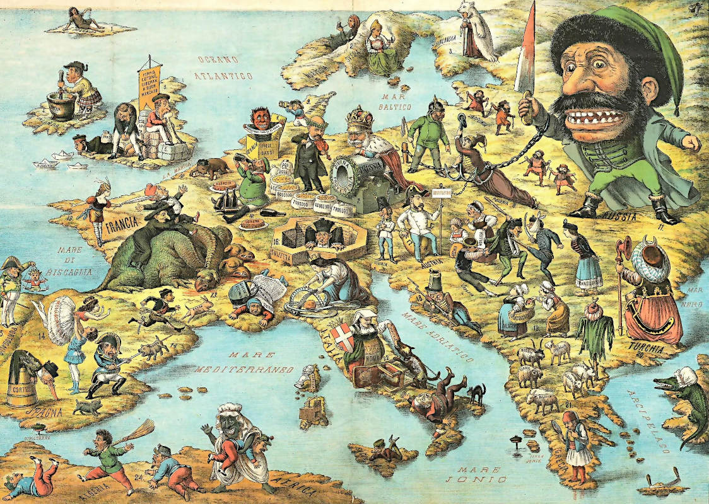
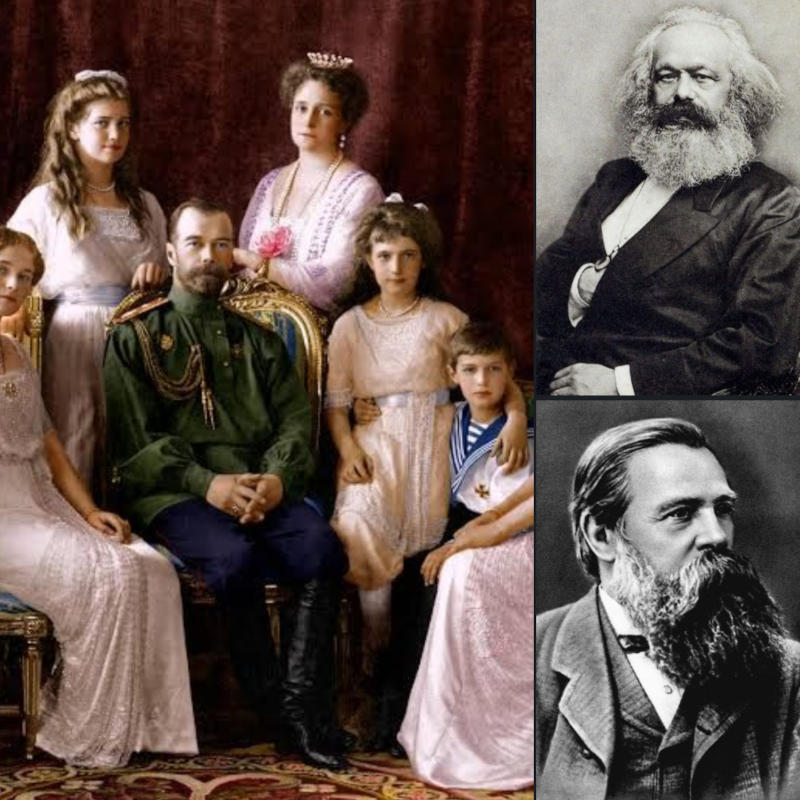
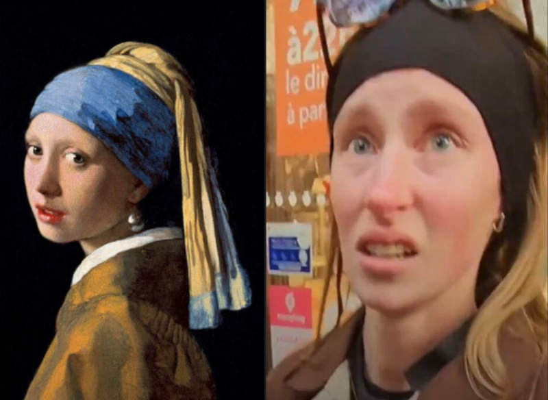

 

### IT IS WORTH TO REMEBER

This is a geo-political satiric map from 1871. At that time Russia was already depicted as a monster oppressing Poland. The hate for Russia has been fabricated before the Soviet Union (CCCP).

However, Russia did not invent Communism. It is a brainchild from two Prussian (DE) philosophers, sponsored by England (UK) and it spread into Russia and China. We created our worst enemies trying to win over them.

The modern USA, more than the far-west epopea, is also a product of our own. It takes a little to check the $1 bill current and old banknotes or the US sigils to understand that we made it as it was and as it is.

It is harder to prove that we also fabricated Islam terrorism, but it is easy to recall that after WW2 the continuation of the original Nazist plan to move forcely Jews in Madagascar to move them in Palestine to create Israel (UK, 1953).

Churchill himself -- even before WW2 was ended -- totally ruined the diplomatic relationship with the Soviet Union which was essential in winning Nazism. CCCP destroyed more than 80% of Germany's military capability.

+

## DO NOT FORGET THE ROOTS

Karl Marx (DE-UK) and Friedrich Engels (DE-DE) were two physophers, actually the fathers of the Communism. That such ideology that inspired URSS and ignited the 1915-8 revolution, by which the Romanov family, ruling over Russia as Zar monarchy have benn killed.

 

 

> Vermeer’s Girl vs Parisien Shoplady illustrates what happens when an idealized figure -- accustomed to a world of curated peace, high concepts, and political/philosophical abstractions -- is forced to step outside the frame and face unvarnished, unpredictable human behavior. -- the [Tweet on X](https://x.com/robang74v2/status/2111666737028681791) and the [Post on LinkedIn](https://lnkd.in/p/de2sH4WF)

+

### I ALREADY SAW IT, BEFORE

We can reasonably agree or disagree. Instead, there is a turn into past history that it is still hard to swallow. The way in which pope Luciani was "replaced" by Woityla and the realted Banco Ambrosiano / IOR scandal, including Calvi unprobable suicide below the "Black Friars" bridge in London.

Let me say something more about it. The MAIN issue with the Church in current times is that Christians believe in 10 commandments and Jesus as Lord as described by "Vangelo" Gospel (CEI). These rules are for them, not expected to be enforced over others.

Others, from the Christian PoVC, should be loved as themselves, they should offer the other chick to be beaten. They had to surrender to the power of their belief and pray for their salvation. Mormones behave in this way.

Un/fortunately, the only Bible rooted religion that enforces the same inhumane unnatural religious laws ALSO against themselves is Islam. What **IF** by the laws of Nature coherent social systems would be more powerful than those based on hypocritical dual-standard attitudes?

+

## Share alike

&copy; 2025, **Roberto A. Foglietta** &lt;roberto.foglietta@gmail.com&gt;, [CC BY-NC-ND 4.0](https://creativecommons.org/licenses/by-nc-nd/4.0/)

