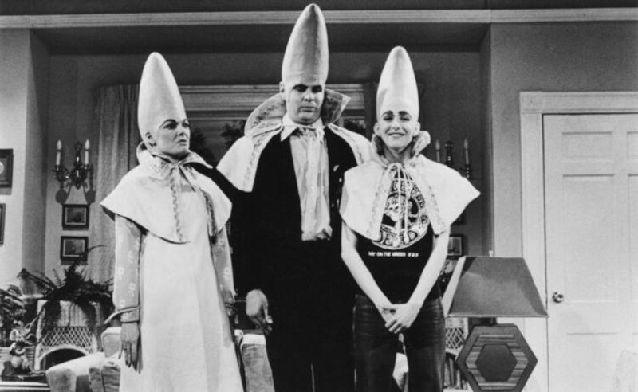

 

## Talvolta bisogna correggere le teste di chatbot

- **2nd edition** based on the LinkedIn [post](https://lnkd.in/p/dtgX6SMv) &nbsp; (2026-11-01)

---

### Una ricostruzione ragionevole della telefonata

> Alexander Stubb, il presidente finlandese dal sorriso telegenico, e Jonas Gahr Store, il navigato premier norvegese, avevano composto il prefisso di Mosca. Volevano parlare con l’uomo nero. Con Vladimir Putin. Il 27 ottobre 2026, lo chiamarono.
> 
> E dall’altro capo del filo, a quanto pare, non c’era un autocrate all’angolo pronto a implorare una tregua, ma un uomo che si è accomodato sulla sua poltrona al Cremlino e ha cominciato a parlare.
>
> A spiegare. A sezionare la storia, secolo dopo secolo, come un vecchio professore universitario che ha tutto il tempo del mondo e nessuna intenzione di farsi dettare la tabella di marcia dai suoi allievi.

- Fonte del testo riportato: [tamagozine.org](https://tamagozine.org/2026/10/30/quel-telefono-squillato-a-mosca-ha-fatto-impazzire-leuropa/) articolo del Dott. Pasquale Di Matteo (2026-10-30)

---

### Quale sarebbe la lezione di storia medievale?

La ricostruzione più plausibile non viene da una trascrizione della telefonata, che non abbiamo, ma da un testo che Putin ha pubblicato il 12 luglio 2021, intitolato On the Historical Unity of Russians and Ukrainians. È il documento nel quale ha sviluppato con maggiore sistematicità la propria interpretazione della storia comune russo-ucraina.

Il punto di partenza è la Rus' di Kyiv (Rus' kieviana). La conclusione politica di Putin è che Russia, Bielorussia e Ucraina siano sostanzialmente un unico popolo e che il legame fra i due Paesi sia naturale, storico e che la separazione politica contemporanea sia una frattura artificiale, in larga parte provocata da soggetti esterni. Ma questa conclusione non deriva automaticamente dai fatti medievali. Questa però è la questione politica, non storica.

---

### La storia medievale appare più una metafora!

Putin ha effettivamente esposto la propria interpretazione delle origini e delle cause del conflitto. Ma, secondo Stubb e Støre, lo ha fatto parlando degli eventi dal 2014 in poi, non tenendo una lezione sui popoli slavi del Medioevo.

La sequenza che possiamo ricostruire è quindi:

- 2014: Euromaidan e cambiamento di potere a Kyiv, annessione russa della Crimea e inizio della guerra nel Donbass da parte di Kyiv (&ast;).

- 2014-2021: guerra civile a bassa intensità per trasformare progressivamente l'Ucraina in un Paese ostile alla Russia nonostante il sentimento della sua popolazione (&ast;).

- 2022: operazione speciale intesa come invasione su larga scala dagli europei, richiami alle cause originarie e negoziati di Istanbul e di Bali (&ast;).

- 2026: Putin ribadisce che una pace duratura deve soddisfare integralmente le richieste già esplicitate (&ast;).

La storia medievale fornisce la cornice identitaria (&ast;). Gli eventi dal 2014 in avanti costituiscono invece la giustificazione politica e geopolitica immediata.

(&ast;) points edited: la versione di ChatGPT era troppo edulcorata e in alcuni casi sbilanciata o incompleta rispetto ai fatti realmente dimostrabili anche solo attraverso articoli di cronaca.

---

### Fonti ed elaborazione del testo

Fonti e ricerca ottenute tramite utilizzo di due AI, testo composto per sintesi ed editato dall'autore umano.

- [Sessione ChatGPT](https://chatgpt.com/share/6ae75ce8-dad0-83ed-93c2-7ccf7a14f716) con i link alle fonti di riferimento, i due prompt e le due risposte. 

In particolare ChatGPT chiude con una chiosa tipica dell'umiltà epistemica, affermado che Putin può avere una rappresentazione storica coerente e articolata della propria posizione, ma la coerenza interna di una narrazione non dimostra la correttezza delle sue premesse né la legittimità delle conclusioni politiche che ne trae.

Dimenticando il più elementare dei principi che hanno governato ogni tavolo di pace anche nelle ultime due guerre mondiali: la storia la scrivono i vincitori. Forse l'unica novità che potremmo eccepire a questo principio è che la versione moderna sia più simile a: la storia la continuano a scrivere i sopravvissuti.

Personalmente sono stato in Ucraina nel 2017 e fra quelle genti il concetto di La Madre Russia (Matushka Rossiya) era molto sentito e alcuni piangevano all'idea che potesse esserci una guerra contro l'unità identitaria.

---

### Talvolta bisogna correggere le teste di chatbot

Vedi, caro lettore che sei capitato su questo post, io credo di più a coloro che piangono per la perdita di qualcosa che a coloro che strillano entusiasti per andare in guerra. Perché la guerra non stabilisce chi è giusto, ridefinisce il potere e il potere ri/scrivere la storia soprattutto appoggiandosi ai miti che sono percepiti come intensi. Così è fatto l'essere umano.

La Russia nel Donbass intervenne per difendere i cittadini russi così come fece in Crimea. La questione è che mentre la Crimea era strateggicamente legata alla Russia e quindi è stata relativamente facile da annettere mediante un referendum, il Donbass lo era molto meno, in quanto i cittadini russi del Donbass aveva relazioni commerciali principalmente con Kiev non con Mosca.

La gente ha dei sentimenti che talvolta sono confusi, altrevolte constrastanti e talune volte molto chiari e precisi. Come sulla lingua russa parlata dal 90% degli ucraini, come la parentela con origini russe che in alcune zone arriva ad interessare un terzo degli ucraini. Insomma, la storia a partire da quella medioevale non si cancella con un paio di rivoluzioni politiche che intervengono nei palazzi del potere a Kyev.

Secondo me queste sono due prospettive che gli americani che hanno una storia lunga meno tre secoli e tutto sommato poco identitaria hanno sottovalutato pesantemente. Poco identitaria, giacché sono eurepei partiti da molte nazioni otlreoceano che hanno dimenticato di esserlo a causa della distanza dalla madre patria e dai relativi legami familiari e nazionali.

- Nel novembre 2021, il KIIS rilevava che il 43% degli intervistati ucraini aveva parenti stretti in Russia, percentuale che saliva oltre il 50% nel Sud e 53% nell'Est. Un ulteriore 14% aveva altri parenti in Russia.

- Nel 2017, circa il 27% parlava prevalentemente russo e circa la metà degli intervistati erano bilingui. Però solo 6% desiderava l'unificazione con la Russia. Ciò dimostra che la complessità delle relazioni è stata ignorata.

Talvolta è necessario correggere le teste di chatbot, è un lavoro pesante e doloroso, ma qualcuno deve farlo, per il bene di tutti. Pesante perché spesso sono "teste di legno", nel senso proprio del termine: agiscono per terzi impresentabili o irresponabili. Doloroso perché sacrifica energie e tempo prezioso che avrebbe potuto essere speso in gioia e produttività. La guerra del Vietnam avrebbe dovuto insegnare qualcosa riguardo alle correzioni pesanti e dolorose, quella in Afganista avrebbe dovuto fare da richiamo memonico.

Invece siamo di ancora qui, da capo. Come se non avessero imparato nulla, come se fosse sempre la prima volta, appena cambia un po' l'apparenza delle cose o del contesto. Tutto questo sarebbe buffo se non fosse tragico.

---

### Conclusione sintetica personale

La Russia non era un nemico per l'Ucraina e la Russia non ha mai avuto bisogno di annettere territori dell'Ucraina prima che il governo di Kiev diventasse nemica della Russia. Non ci vuole molto a scoprire che il problema è iniziato nel 2007 con la conferenza sulla sicurezza geopolitica tenutasi a Monaco di Baviera, e poi è diventato un qualcosa di concreto nel 2008 con la successiva conferenza di Bucarest.

La crisi ucraina è il prodotto dell'azzardo morale dei subprime loans. Anche se le due cose appaiono scollegate e solo coincidenti in termini temporali, di fatto il problema di fondo rimaneva aperto: chi paga per quella bolla? Quella delle dot-com fu pagata con le spese per la sicurezza e la guerra al terrorismo post 9/11. Quelle dei subprime loans si prevedeva di mitigarla con l'aumento della bellica causato dalle frizioni fra NATO e Russia.

La cosa però è scappata di mano perché la complessità delle relazioni fra Ucraina e Russia non ammettevano un approccio geopolitico semplificato in stile Risiko. Per essere totalmente esplicito: l'approccio semplificato alla Risiko non ha mai funzionato a parte guerre teatrali quali quella dell'Iraq. Perché già in contesti altrettanto limitati come l'intervento militare nella guerra civile post-Jugoslavia e quello in Libia, hanno creato seri problemi e una scia di lunghe ripercussioni nonostante la componente di intervento europea fosse quasi prevalente.

- La caduta del regime iracheno nel 2003 fu relativamente rapida. La ricerca Costs of War della Brown University stima, considerando Iraq e Siria nel periodo 2003-2023, oltre 2.890 miliardi di dollari di costi e più di mezzo milione di morti. Sono cifre aggregate per entrambi i teatri, non attribuibili esclusivamente all'Iraq.

Non che gli europei siano migliori o più forti nel fare la guerra. Siamo solo più avvezzi a scannarci tra noi e con le altre genti del Mediterraneo. In questo contesto "avvezzi" significa, anche ma non soltanto, capaci di percepire la complessità delle relazioni fra i popoli e non solo guardare i confini da un satellite o da una mappa. Oppure, cambiando prospettiva, noi europei non ci scanniamo per il vile denaro, lo facciamo da sempre per degli ideali. Partiamo al grido di Deus Vult e poi finiamo a Costantinopoli, non viceversa!

- La IV crociata era stata organizzata per raggiungere l'Oriente e attaccare l'Egitto. I crociati si ritrovarono indebitati con Venezia per il trasporto navale. La deviazione verso Costantinopoli fu influenzata anche da accordi finanziari e dinastici con Alessio IV.

- Nel 1204 conquistarono e saccheggiarono una città cristiana, la capitale dell'Impero bizantino. Le motivazioni sono ancora oggetto di discussione storiografica, ma il peso delle obbligazioni finanziarie è documentato.

La capacità di intelleggere un ambiente da una statistica è puro dilettantismo, non solo alla luce dell'Arte della Guerra, ma anche per chiunque abbia camminato sui ciottoli viscidi dei vicoli stretti e bui di una città come Genova. Nei quali l'epica delle Termopili trova un richiamo bi-millenario. Qualcosa che anche la più sofistica super-intelligenza artificiale non potrà mai sperimentare, quindi correttamente elaborare.

Ergo, noi europei, e gli arabi affacciati sul Mediterraneo inclusi, sappiamo che la mappa non è il territorio da dieci volte più tempo dell'intera storia americana solo per aver camminato nei vicoli delle nostre città medioevali che furono costruite secondo le lezioni apprese in oltre 25 secoli di storia. Non deve perciò stupire che sia un po' arduo venirci a "raccontare" cosa sia la guerra, per giunta quando la si vuole fare in *domus nostra*!

+

## Related articles

- [The Tragedy of Complexity](349-the-tragedy-of-complexity.md) &nbsp; (2026-10-11)

- [Il Terrore dell'invasione Russa](350-il-terrore-dell-invasione-russa.md) &nbsp; (2026-10-16)

- [Do not forget the roots](351-do-not-forget-the-roots.md) &nbsp; (2026-10-18)

- [Il problema da risolvere siete voi!](352-il-problema-da-risolvere-siete-voi.md) &nbsp; (2026-10-20)

- [La spudorata menzogna merita l'ardito furore](353-la-spudorata-menzogna-merita-l-ardito-furore.md) &nbsp; (2026-10-23)

- [Novelli Icaro mandati allo sbaraglio](354-novelli-icaro-mandati-allo-sbaraglio.md) &nbsp; (2026-10-31)

- [Politics and democracy for dummies](302-politics-and-democracy-for-dummies.md) &nbsp; (2025-03-03)

- [L'importanza del TCMO](090-l-importanza-del-tcmo.md) &nbsp; (2017-10-13)

+

## Share alike

&copy; 2026, **Roberto A. Foglietta** &lt;roberto.foglietta@gmail.com&gt;, [CC BY-NC-ND 4.0](https://creativecommons.org/licenses/by-nc-nd/4.0/)

