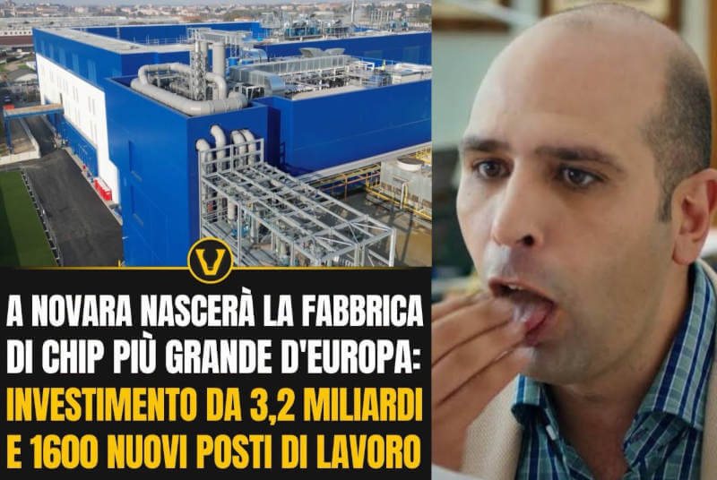
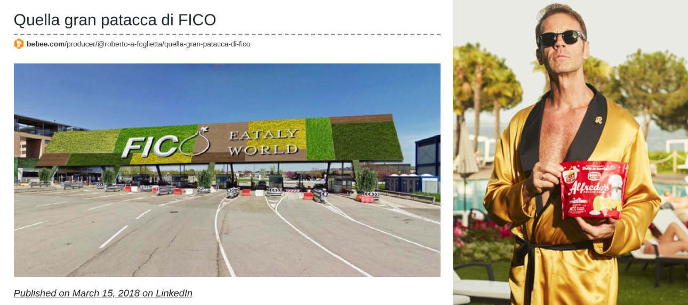

 

## Food vs Chips, not chips, but packaging!

- 1st edition: started on LinkedIn by this [post](https://lnkd.in/p/dekNX2V2) prosecuting in the pinned [comment](https://lnkd.in/p/dHaDJDtr).

---

### Not chips, but packaging!

In pratica, in termini tecnici: altri fanno i chip e a Novara li integreranno in una lastra di silicio invece di doverli montare su una scheda PCB, così da evitare i limiti e i rallentamenti del montaggio separato su una scheda PCB tradizionale. Assemblaggio di schede elettroniche, ma con una tecnologia che dipende da una società a Singapore, dove è ragionevole che confluirà la maggiore frazione degli utili per via della bassa fiscalità.

In pratica, in termini economici: il Piemonte ci mette il terreno e gli operai (a buon mercato), il fondo europeo finanzia la costruzione, la società privata e non quotata che licenzia la tecnologia ricava gli utili a Singapore, a noi Italia resta il debito da ripianare. Non è nemmeno il paradigma di essere la Taiwan d'Europa, è ancora il paradigma di essere la Cina d'Europa, ma lo stabilimento lo paghiamo noi altrimenti lo facevano in Cina, con i soldi loro.

In pratica, in termini finanziari: Invece, lo fanno qui con i soldi nostri al 40%,  mentre i restanti 1,9 miliardi di euro sono capitale privato investito dall'azienda, che ha aperto all'ingresso di soci finanziari italiani (enti pubblici, INPS, fondi pensione e banche, eventualmente investitori esteri interessati a vendere i loro chip da assemblare). Ma l'azienda aperta agli investitori, non compra la licenza per quella tecnologia, l'azienda aperta ai fondi privati investe nell'impianto ciò una stampante il cui prezzo delle cartucce d'inchiostro è deciso a Singapore.

In sintesi: è il modello FICO a Bologna, vantare eccellenza e fallire a ruota libera. Il parco non è mai fallito in tribunale, ma attraverso almeno 4 importanti tentativi di rilancio e/o ristrutturazione (2017-2026) per evitare il crac finanziario, nonostante le continue ricapitalizzazioni dei soci (Farinetti, Coop Alleanza, Casse previdenziali, Fondo PAI) le vendite hanno sempre chiuso in perdita.

---

### Novara Facility, oveview

The chip facility planned in Novara (the Vulcan Project by Singapore-based Silicon Box in Agognate) will use advanced panel-level packaging, chiplet integration, and testing technology rather than front-end silicon wafer fabrication.

- 1. Chiplet integration: Combines multiple smaller, specialized chips ("chiplets") into a single package that functions as one processor, improving efficiency and cost compared to building one giant monolithic die. (Forbes)

- 2. Panel-level packaging (PLP): Processes chips on large-format panels rather than smaller round wafers to increase output and lower unit costs. (Silicon Box Pte Ltd)

- 3. Back-end assembly and testing: Handles post-wafer manufacturing—assembling, interconnecting, and testing chips for applications such as AI, supercomputing, electric/autonomous vehicles, robotics, mobile devices, and space tech. (La Tech)

The Novara future plant will handle advanced packaging and testing rather than silicon wafer fabrication. It is an interconnect technology to link chiplets that are already etched elsewhere (Silicon Box Pte Ltd).

---

### Food vs Chips

 

Come se non sapessi cos'era FICO Eataly World a Bologna (è stato inaugurato per la prima volta il 15 novembre 2017) già 4 mesi dopo la sua inaugurazione (apertura al pubblico).

* [176-Quella_gran_patacca_di_FICO.pdf](https://raw.githubusercontent.com/robang74/roberto-a-foglietta/refs/heads/main/pdf.todo/176-Quella_gran_patacca_di_FICO.pdf) &nbsp; (2018-03-15)
> L'articolo tratta in chiave critica la vicenda FICO e, più in generale, il rapporto tra marketing urbano, istituzioni e cittadinanza. Attraverso una narrazione informale, sarcastica e volutamente accessibile, l'autore mette in discussione l'efficacia reale del progetto, i suoi costi e le sue ricadute sul territorio, invitando a leggere oltre l'immagine promozionale per coglierne le contraddizioni tra obiettivi dichiarati e risultati percepiti.

* [178-L_insostenibile_leggerezza_di_FICO.pdf](https://raw.githubusercontent.com/robang74/roberto-a-foglietta/refs/heads/main/pdf.todo/178-L_insostenibile_leggerezza_di_FICO.pdf) &nbsp; (2018-03-24)
> Questo secondo articolo riprende la critica all'operazione FICO (Fabbrica Italiana Contadina) già avviata in quello precedente, approfondendone però gli aspetti più strettamente economici e finanziari. L'autore analizza il modello imprenditoriale, i finanziamenti pubblici e privati e l'eccessivo tono celebrativo del progetto rispetto alla reale situazione dell'agroalimentare italiano, mettendo in dubbio la sostenibilità dell'iniziativa, la sua trasparenza e gli effettivi benefici per piccoli produttori e consumatori.

L'analogia con FICO ci permette di osservare un pattern ricorrente che converge con altre decisioni "particolari" come il reddito di cittadinanza (2018 erogato 2019), resilienza Covid (2019 erogato 2020), super-bonus edilizio (2020 erogato 2021), finanziamento all'Ucraina (1° erogato nel 2022), etc. e qual'è questa convergenza?

> FICO Eataly World (Fabbrica Italiana Contadina) a Bologna è stato sviluppato principalmente tramite il Fondo PAI (Parchi Agroalimentari Italiani), istituito e gestito da [Prelios SGR](https://prelios.com/it/news/prelios-sgr-lancia-il-fondo-pai-lo-sviluppo-del-progetto-fico-eataly-world). Le casse di previdenza private di categoria professionale che hanno sottoscritto quote del Fondo PAI, in ordine di esposizione: Fondazione Enpam (ente previdenziale di medici e odontoiatri) per €14 milioni, Cassa Forense (cassa di previdenza degli avvocati) per €10 milioni, Epap (ente di previdenza dei pluriiscritti) per 8 milioni. Nel complesso, gli enti previdenziali privati hanno sottoscritto circa il 38% del Fondo PAI, pari a circa €48 milioni di euro su un investimento immobiliare complessivo di circa €120 milioni.

- Non si può destrutturare lo stato, lo si manda in fallimento per farlo commissariare, cattivi gli quelli che verranno poi a tagliano il personale e ottimizzano le risorse, però poi gli indici economici andranno molto meglio infatti dopo il default e commissariamento della Grecia, oggi la Grecia è meglio di noi, sui bilanci.

- Non possono chiudere l'INPS, quindi la svuotano, mandando in bancarotta le casse previdenziali di categoria. A quel punto dovranno essere accorpati con l'INPS che andrà in fallimento, di fatto anche se non giuridicamente parlando.

- Analogamente faranno con Cassa Depositi e Prestiti (CDP), il forziere dello Stato dopo che la Banca d'Italia è confluita nel regime bancario europeo, passando per PostePay (capitale separato) tramite carte intestate a stranieri usate fraudolarmente come reddito di criminanza (anche e sopratutto da italiani), che sarà integrata nel capitale di BancoPoste (digitalizzata fraud-friendly e partner bancario di Deutsche Bank con almeno €981 milioni in titoli tossici), che confluirà in CDP che alla fine pagherà per INPS e garantirà per tutti i prestiti presi dalla BCE grazie alla mangnaminità dell'Unione Europea.

* [La cartolarizzazione del lavoratore](https://robang74.github.io/roberto-a-foglietta/html/linkedin/la-cartolarizzazione-del-lavoratore-roberto-a-foglietta.html) anche su [LinkedIn](https://www.linkedin.com/pulse/la-cartolarizzazione-del-lavoratore-roberto-a-foglietta/) &nbsp; (2017-10-27)
> L'articolo parte da un caso di cronaca su un'assunzione fittizia per denunciare la «cartolarizzazione del lavoratore» e del suo curriculum, vista come strumento per stornare risorse aziendali, ottenere indebiti vantaggi o gestire il personale come merce anziché come capitale umano. Attraverso digressioni storiche e giuridiche — dai romani al capitalismo moderno, fino alla depenalizzazione del falso in scrittura privata e di alcuni illeciti sul lavoro — l'autore lega il fenomeno a dinamiche di abuso gestionale e a una scarsa valorizzazione delle competenze reali.

* [Assalto alle Poste, la grande rapina](https://robang74.github.io/roberto-a-foglietta/html/linkedin/assalto-alle-poste-la-grande-rapina-roberto-a-foglietta.html) anche su [LinkedIn](https://www.linkedin.com/pulse/assalto-alle-poste-la-grande-rapina-roberto-a-foglietta/) &nbsp; (2018-12-27)
> L'articolo critica in chiave polemica l'ipotesi di impiegare Cassa Depositi e Prestiti e il circuito legato a Poste Italiane in operazioni di venture capital e sostegno a start-up innovative, ritenendo improprio mescolare il risparmio tradizionale con investimenti ad alto rischio. Richiamando anche vicende come il salvataggio di Alitalia e la concessione ad Amazon per le consegne, l'autore mette in guardia contro l'elevato tasso di fallimento delle start-up, il rischio di dispersione del valore e la perdita di tutela per i risparmiatori.

* [Assalto alle Poste, la grande rapina, p.2](https://robang74.github.io/roberto-a-foglietta/html/linkedin/assalto-alle-poste-la-grande-rapina-p2-roberto-a-foglietta-nz7uf.html) anche su [LinkedIn](https://www.linkedin.com/pulse/assalto-alle-poste-la-grande-rapina-p2-roberto-a-foglietta-nz7uf/) &nbsp; (2024-01-26)
> Questo secondo articolo riprende la critica sui rischi di snaturamento di Poste Italiane avviata nel testo precedente, spostando però il focus dall'impiego nel venture capital all'ipotesi di cessione di quote azionarie ai privati e al ruolo dell'azienda nel dibattito sull'identità digitale. L'autore denuncia il rischio di spingere l'ente verso logiche più commerciali e meno pubbliche, esaminando i rapporti tra politica, autonomia gestionale, centralizzazione dei dati personali e sicurezza informatica.

~~~~

### Liquidazione totale

Immediatamente dopo la "Cartolarizzazione del lavoratore" ci sarebbe stato da scrivere un articolo sulla gestione e recupero forzoso del credito insoluto e/o a rischio che quando il creditore di prima istanza va in forte sofferenza, ripulisce i bilanci cedendolo a società private.

Società che formalmente registrate come opertori finanziari si affidano a sub-appaltatori di non specchiata onestà i quali in genere sfruttano la delega del recupero credito forzoso per aggredire il patrimonio delle persone, anche giuridiche, attigue al debitore e in questo contesto emerge la logica estrema della socializzazione delle perdite.

Perché vengono coinvolti in maniera spietata e fraudolenta chiunque, dalla gestione dei condomini, ai vicini, ai colleghi, ai manager, chiunque inclusi omonimi totalmente estranei e geograficamente separati. Non rimangono estranei gli avvocati e per estensione sia il mondo giudiziario, sia quello amministrativo e anche i sindacati.

Fra tutte, spiccano particolarmente le cooperative sociali (e la gestione del servizio di ambulanze mediche) che spesso si avvalgono di manovalanza a basso costo fornita dai servizi sociali anche dei criminali da riabilitare. Lo stesso Silvio Berlusconi fu punito con questa forma di "partecipazione sociale" al fine di riabilitazione.

Qualsiasi relazione possa esistere o anche solo essere supposta, diventa un veicolo per costruire schemi di Ponzi al fine specifico di aumentare la massa di coloro che potrebbero contribuire all'estinzione del debito primario. L'informatica ha infatti permesso di potenziare enormemente la capacità di infiltrazione sia fra privati, aziende, e pubbliche amministrazioni.

Un debito che in realtà non si estingue mai, qualora già in principio non fosse stato creato per frode o truffa. Perché dietro a queste dinamiche, c'è la macchina finanziaria che fornisce voti ai candidati politici, quelli che non vi aderiscono hanno zero probabilità di essere eletti, spesso anche i non eletti vengono sistematicamente truffati.

Quindi è un ciclo infinito di costruzione e distruzione di relazioni, e relative società che producono cartolarizzazioni e coperture di serietà, che fondamentalmente si basa sulla concessione di prebende attraverso complicate, opache e spesso fraudolente relazioni fra "persone rilevanti" e riciclaggio di denaro.

* [Italia: fuga di cervelli e falso documentale](https://robang74.github.io/roberto-a-foglietta/html/330-italia-fuga-di-cervelli-e-falso-documentale.html) &nbsp; (2025-07-01)
> L'articolo esamina in chiave critica e polemica il declino della competitività industriale italiana e la fuga di cervelli, collegandoli a una carenza di competenze STEM e a una gestione del rischio ridotta a mera conformità formale e "falso documentale". Prendendo spunto da episodi recenti — come il cedimento dell'insegna sulla torre Generali a Milano e la vicenda dei componenti difettosi legati a Leonardo e Boeing — l'autore sostiene che il ricorso a coperture assicurative e a controlli solo cartacei mascheri una deriva sistemica e una scarsa aderenza alla realtà.

Il "sistema italia" è una iattura che perseguita i cittadini anche quanto emigrano, specialmente se rimangono nell'ambito dell'Unione Europea, perché non dimentichiamolo che noi abbiamo esportato il nostro modello all'Europa, altrimenti gli altri politicanti non avrebbero potuto competere.

* [The paper money is financial communism](https://robang74.github.io/roberto-a-foglietta/html/278-the-paper-money-is-financial-communism.html) &nbsp; (2024-07-31)
> L'articolo — ampliato in più edizioni con digressioni storiche e aggiornamenti geopolitici — definisce «comunismo finanziario» l'espansione monetaria tramite valuta fiat, quantitative easing e cartolarizzazione, sostenendo che concentri il controllo delle risorse a scapito dell'economia reale e della scarsità materiale. Nelle edizioni successive l'autore collega questo impianto teorico alla tassazione delle plusvalenze non realizzate, al peso di energia e semiconduttori (tra Taiwan, Medio Oriente e filiere globali) e alle conseguenze geopolitiche della rimozione di Maduro in Venezuela sul debito e sull'assetto del dollaro.

~~~~

### Il modello italico

Un'esportazione, quella del "modello italico" che ha conquistato non solo la politica europea ma anche la sua finanza ai vertici. Perché non dimentichiamoci che è Mario Draghi fu governatore della BCE e firmo di suo pugno lo sdoganamento del quantitative easing come politica monetaria.

Con Draghi alla BCE e poi durante la pandemia del Covid-19, il "modello italico" ha dominato da dietro le quinte la politica e la finanza dell'Unione Europea in tripudio infinito di creazione di linee di credito atte a generare nuova liquidità, gratificare le borse.

Fra i tanti disastri, il QE decennale ha creato un nuovo picco di inflazione dei prezzi al consumo che aumentando il PIL supporta il concetto di "sostenibilità" del debito pubblico, se non fosse che questo in Italia è cresciuto più della produzione.

La guerra da vincere contro la Russia in poche settimane con le sanzioni e due cannonate ben piazziate era la pianificazione del traferimento del debito insolubile internamente. Un evergreen di ogni impero coloniale. Peccato che la realtà avesse altri piani.

* [Talvolta bisogna correggere le teste di chatbot](https://robang74.github.io/roberto-a-foglietta/html/355-talvolta-bisogna-correggere-le-teste-di-chatbot.html) &nbsp; (2026-11-01)
> L'articolo prende spunto da una telefonata tra i leader di Finlandia e Norvegia e Putin per criticare le narrazioni semplificate sul conflitto russo-ucraino, sia quelle istituzionali sia quelle prodotte dall'intelligenza artificiale. Attraverso una riflessione polemica e storica — che intreccia radici medievali, dinamiche linguistiche e familiari, conferenze del 2007-2008 e ripercussioni finanziarie dei subprime — l'autore contesta gli approcci geopolitici riduttivi e rivendica il peso dell'esperienza storica e territoriale europea rispetto a letture astratte o algoritmiche.

* [Trump senza maggioranza e trilaterale in Cina](https://github.com/robang74/working-in-progress/blob/main/texts-in-draft/trump-senza-maggioranza-trilaterale-in-cina.md#il-trilaterale-in-cina) &nbsp; (2026-11-08)
> L'articolo analizza in chiave polemica e sarcastica l'assetto geopolitico ed economico successivo alle midterm americane, collegando Ucraina, Unione Europea, Cina, semiconduttori e sicurezza infrastrutturale in un'unica lettura sistemica. Attraverso un registro diretto e provocatorio, l'autore mette in discussione la tenuta politica ed istituzionale dei principali attori occidentali — dalla debolezza post-elettorale di Trump alle divisioni interne dell'UE e alla legittimità di Kiev — spostando il baricentro strategico verso Pechino, il controllo delle filiere tecnologiche e le vulnerabilità strutturali europee, accostate anche all'uscita anticipata di Christine Lagarde dalla BCE.

---

### La cura da cavallo

Trasparenza. In Unione Sovietica la chiamarono Glasnost e dopo l'incidente di Chernobyl hanno deciso che era indispensabile per la Perestroika (cambiamento). Penso che si ricordi che è venuto giù tutta l'URSS nel giro di sei anni.

Cinque anni e un mese per la precisione dalla fine della prima fase dell'inchiesta interna su Chernobyl (durata 4 mesi) alla dissoluzione dell'URSS: 26 aprile 1986 + 4 mesi al 25 dicembre 1991 (ufficializzata in occidente il 31 dicembre 1991, ossia al suo completamento in 6
giorni).

L'Unione Sovietica iniziò con la rivoluzione di ottobre del 1917 (7 novembre secondo il nostro calendario) ed è durata 74 anni. Abbiamo appena fatto in tempo ad accorgercene (muro di Berlino, 9
novembre 1989)  che stava collassando, che era già finita.

Tutti gli imperi sono eterni, fino alla settimana prima della loro caduta (semcit.) poi improvvisamente ci si accorge che tutto quanto è umano ha un'inizio e una fine. Ma c'è un aspetto particolarmente drammatico: per fare chiarezza servono persone lucide, intelligenti e radicalmente oneste che siano abbastanza coraggiose da affrontare la "libertà di parola" concessa dal sistema.

Inutile dire che tanto la Cancel Culture, quanto l'ideologia Woke (incluso Friday for Future abbandonato per il più divisivo Free Palestine), poi l'odio e la guerra contro la Russia hanno fornito eccezionali strumenti per emarginare queste "menti pericolose".

Perché fondamentalmente tutti questi movimenti come lo è stato il Movimento 5 Stelle, sono buonissimi per sembrare benpensanti in un salotto di società, ma in realtà sono oscenità di propaganda, un insulto al buon senso e l'apice della violenza del doppio standard.

* [Novelli Icaro mandati allo sbaraglio](https://robang74.github.io/roberto-a-foglietta/html/354-novelli-icaro-mandati-allo-sbaraglio.html) &nbsp; (2026-10-31)
> L'articolo critica in modo pungente la cultura del fake it till you make it e la trasposizione acritica dei modelli del software e della finanza speculativa a settori vincolati da leggi fisiche, chimiche, industriali e regolatorie. Partendo dal caso Theranos e toccando debito tecnico, uso dell'intelligenza artificiale nello sviluppo software, dinamiche di mercato e tempi storici dell'innovazione, l'autore sostiene che il distacco tra rappresentazione finanziaria e realtà materiale porti a derive sistemiche che finiscono per scontrarsi con i limiti oggettivi del reale.

Per capire quanto questa mentalità della "confezione  sopra la sostanza" sia devastante, non servono voli pindarici, basta osservare gli effetti sull'impresa, che dovrebbe essere il motore della produzione di valore, e l'accoppiata Holmes / Theranos è un eccellente caso scuola.

Da Greta Thunberg a Elizabeth Holmes, il passo è breve. Da raccogliere fondi per una causa a fare la medesima cosa per vendere un prodotto reale che dovrebbe funzionare. Il basso è breve, quel poco che è l'alzarsi dalla poltrona delle chiacchiere a cercare di cucinare un piatta di pasta.

---

### Conclusione

In estrema sintesi, il sistema è -- ormai ufficialmente, guardando i listini di borsa e i dati delle Camere di Commercio -- in liquidazione coatta e da parecchi anni, non da ieri. Non penso serva aggiungere altro, anche se probabilmente altro sarà aggiunto.

+

## Share alike

&copy; 2026, **Roberto A. Foglietta** &lt;roberto.foglietta@gmail.com&gt;, [CC BY-NC-ND 4.0](https://creativecommons.org/licenses/by-nc-nd/4.0/)

