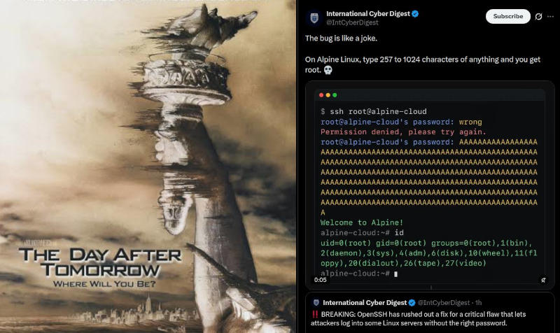

 

### THE 0-DAY AFTER TOMORROW

- Sourced: [lnkd.in/p/dfJY9XiZ](https://lnkd.in/p/dfJY9XiZ) (on LinkedIn)
- Doubled: [x.com/robang74v2/status/2125584449244983675](https://x.com/robang74v2/status/2125584449244983675) (on X)

(*writing in live stream, a paragrpah each 5 minutes, starting from 2pm UTC*)

1. Geeks have fun but SSHole wasn't a joke. In Busybox .net the mitigation passed within a DES legacy (weak) password support. It would be unfair to blame them when the whole "IT industry" is pressing for "continuity" and the combination of two paradigms brings in the "tomorrow".

2. Vulnerable Alpine containers are still available. Anyone can download & run them on docker. Removing them, even if possible, would break a lot of CD/CI chains. Then the need for updates and who uses _last are already fine. Many other DEV servers cannot due to "certifications".

3. NSA is pressing about SP 800-90B adoption but it is just a "certification" [1] while the "IT industry" relies [2] on edge devices with a random.c that isn't even white-noise compact as distribution [3]. Herd behavior kick in, and when they do on power transmission networks: ouch! [4]

4. As we can see, this CoT is just a mere introduction to hot-fridges and black-out crysis: over-constraints kill, more than creativity, the same value they initially want to preserve. Update a product is a thing, updating the DEV is totally another THING, so the vulnerabilty stays.

5. It stays in protected DEV: a vulnerable container can leak when it starts as user and the user can do a local privilege escalation. Can leak as root or suid [5] and the user that has also DEV local access as user, can escalate as DEV root. It a step-by-step well-known pattern.

6. At this point the picture is clear: once DEV is compromised the whole "industrial IT" production is compromised, despite being totally "certified". It means that, potentially, billions of devices are compromised even if certified as safe and secure, without bugs or vulnerabilities.

7. Is this a joke? Wait for the links. Just note that the gzip FEXTRA field hasn't been challenged [6] since 1996, the random.c hasn't since 2009. There are sitting there, in your safe, secure and bug-free "certified" devices, including automotive, trains, airplanes, medical, etc.

### LINKS

- [1] [lnkd.in/dcwnTkb8](https://lnkd.in/dcwnTkb8),&nbsp; [2] [lnkd.in/p/dq2rFFs8](https://lnkd.in/p/dq2rFFs8),&nbsp; [3] [lnkd.in/d9JXDBtz](https://lnkd.in/d9JXDBtz)
- [4] [lnkd.in/di4xp9xx](https://lnkd.in/di4xp9xx),&nbsp; [5] [lnkd.in/dJwevQ8T](https://lnkd.in/dJwevQ8T),&nbsp; [6] [lnkd.in/dRmRW8MT](https://lnkd.in/dRmRW8MT)

(*writing in live stream, completed at 3:15 pm UTC*)

---

### THIS BUG IS LIKE A JOKE!

- Linkedin: [lnkd.in/p/d4-xGpU6](https://lnkd.in/p/d4-xGpU6)

On Alpine Linux, type 257 to 1024 characters of anything and you get root. 

By now, "they just made a login" sounds in a completely another way...  🤗  🍌 

- [lnkd.in/daQGeEBg](https://lnkd.in/daQGeEBg) (image origine)

- [lnkd.in/dPsHmwzE](https://lnkd.in/dPsHmwzE) (CVE on NIST)

A critical vulnerability in OpenSSH that remained hidden for ten years, since 2016 and also the name is like a joke: &ast;sshole!

---

ChatGPT confirms The 0-Day After Tomorrow.

- LinkedIn: [lnkd.in/p/d98Uc_mP](https://lnkd.in/p/d98Uc_mP)
- Session: [chatgpt.com/share/6b070445-00c8-83eb-9990-caf4147869bb](https://chatgpt.com/share/6b070445-00c8-83eb-9990-caf4147869bb)

*Elaborato per 2m 37s*

> Now the links make the architecture of the argument much clearer. They also expose some important distinctions that I would preserve rather than smoothing them over.
> 
> My overall reading is that "The 0-Day After Tomorrow" is not really about discovering another vulnerability. It is about discovering what happens when independently accepted engineering assumptions interact in a production ecosystem.
> 
> [...]
> 
> The strongest concluding proposition would be:
> 
> Certification establishes that something has been evaluated against defined requirements. It does not establish that the assumptions behind those requirements will remain valid throughout the operational lifetime of the system.
> 
> And that, to me, is the real meaning of The 0-Day After Tomorrow.

+

## Share alike

&copy; 2026, **Roberto A. Foglietta** &lt;roberto.foglietta@gmail.com&gt;, [CC BY-NC-ND 4.0](https://creativecommons.org/licenses/by-nc-nd/4.0/)

